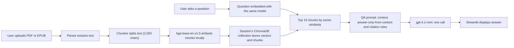

# AI Reading Companion

[Live Demo](https://ai-reading-companion.streamlit.app)

AI Reading Companion is a Streamlit app that lets you upload a PDF or EPUB, ask questions about it, and get answers grounded in the document's text, with citations to the chunks the answer came from.

Under the hood it is a single-step retrieval-augmented generation (RAG) pipeline:

- the document is split into overlapping chunks of about 2,000 characters;
- each chunk is embedded locally with `BAAI/bge-base-en-v1.5` and stored in an in-memory ChromaDB collection;
- for each question, the 15 most similar chunks are retrieved and sent with the question to `gpt-4.1-mini`, which is instructed to answer only from that context and to cite chunk IDs.

## What It Does

Instead of searching a long PDF or EPUB by hand, you can ask questions like:

- What does the author say about a specific topic?
- What happens to a specific character?
- What evidence supports the author's argument?
- Where does the document talk about a specific event?

Each answer is written by the LLM from the retrieved chunks and cites them, e.g. "(Chunk 47)". Questions about the whole document (overall themes, summaries of large sections) only see the 15 retrieved chunks, so answers to them are partial.

## Why This Project Matters

AI Reading Companion shows applied machine learning engineering of the kind that shows up in real AI products:

- Building a usable app around an LLM, not just a notebook demo
- Parsing messy real-world documents from multiple formats
- Creating embeddings with a local transformer model
- Indexing and querying chunks with a vector database
- Grounding generated answers in retrieved source context
- Designing prompts that require citations and reduce hallucination risk
- Measuring retrieval and answer quality with an evaluation harness, and testing retrieval changes against it

## Features

- Upload `.pdf` or `.epub` documents
- Extract text from PDFs (`pypdf`) and EPUBs (EbookLib + BeautifulSoup), removing Project Gutenberg header and license text when present
- Split text into overlapping character-based chunks (2,000 characters, 100 overlap), breaking at blank lines, newlines or sentence ends
- Embed chunks locally with `BAAI/bge-base-en-v1.5` via Sentence Transformers (no embedding API calls)
- Store chunks in an in-memory ChromaDB collection, one per browser session
- Retrieve the 15 most similar chunks for each question
- Answer with `gpt-4.1-mini` through OpenAI's Responses API, with chunk citations
- Evaluate retrieval and answers with the harness in `eval/` (see [Evaluation](#evaluation))

## Demo Flow

1. Open the [live Streamlit app](https://ai-reading-companion.streamlit.app) or run it locally.
2. Upload a PDF or EPUB document.
3. Click **Build Knowledge Base**.
4. The app parses the document, splits it into chunks, embeds them and indexes them in ChromaDB.
5. Ask a question in the text box.
6. The app retrieves the 15 most relevant chunks, sends them to `gpt-4.1-mini` with the question, and shows the answer with chunk citations.

## Tech Stack

| Area | Tools |
| --- | --- |
| App framework | Streamlit |
| LLM | `gpt-4.1-mini` via the OpenAI Responses API |
| Embeddings | `BAAI/bge-base-en-v1.5` via Sentence Transformers, run locally |
| Vector database | ChromaDB (in memory) |
| PDF parsing | `pypdf` |
| EPUB parsing | EbookLib, BeautifulSoup |
| Text chunking | LangChain `RecursiveCharacterTextSplitter` |
| Evaluation | Python standard library, OpenAI (`gpt-4.1` as judge), matplotlib (report) |
| Configuration | python-dotenv |
| Deployment | Streamlit Community Cloud |
| Language | Python |

## Architecture



Answering is a single retrieve-then-answer step: one vector search and one LLM call per question. There are no tools, no multi-step planning and no conversation memory. The class that does this is named `Agent`, but it runs a fixed pipeline.

## Project Structure

```text
ai-reading-companion/
|-- app.py                  # Streamlit UI; one VectorStore and Agent per browser session
|-- core/
|   |-- agent.py            # Agent.run: retrieve the top 15 chunks, build the prompt, call gpt-4.1-mini
|   |-- chunker.py          # chunk_text: character-based RecursiveCharacterTextSplitter
|   |-- embeddings.py       # embed_chunks helper (not used by the app; VectorStore embeds directly)
|   |-- parser.py           # PDF and EPUB text extraction, Gutenberg boilerplate removal
|   `-- vectorstore.py      # VectorStore: embeds chunks, per-session ChromaDB collection, search
|-- prompts/
|   `-- templates.py        # QA_PROMPT (used); SUMMARY_PROMPT and CHARACTER_PROMPT (not wired in yet)
|-- eval/                   # Evaluation harness; see eval/README.md
|-- tests/
|   |-- test_parser.py      # Parser unit tests
|   `-- test_vectorstore.py # Session-isolation tests for the vector store
|-- sample_books/           # Local test books (git-ignored)
|-- requirements.txt        # Python dependencies
`-- README.md
```

## How It Works

### 1. Document Parsing

PDFs are read page by page with `pypdf`; EPUBs are read item by item with EbookLib, and BeautifulSoup extracts the text from each HTML document. Whitespace is collapsed, and pages or chapters are joined with blank lines, so paragraph breaks inside a chapter are not kept. Project Gutenberg's header and license text are removed when the book has the standard start and end markers.

### 2. Chunking

Chunking is character-based, not semantic. LangChain's `RecursiveCharacterTextSplitter` cuts the text into chunks of at most 2,000 characters with 100 characters of overlap, breaking at a blank line, a newline or a sentence end (`". "`), in that order of preference. A passage with none of these breaks can produce a chunk longer than 2,000 characters.

### 3. Embeddings

Each chunk is embedded locally with `BAAI/bge-base-en-v1.5` through Sentence Transformers: 768-dimensional, normalized vectors, from at most 512 tokens per chunk (nearly every 2,000-character chunk fits). Questions are embedded with the same model. No embedding API is called, so only answering uses the OpenAI API.

### 4. Vector Search

Chunks, vectors and a `chunk_num` for each are stored in an in-memory ChromaDB collection with Chroma's default settings (an approximate HNSW index with L2 distance). Every `VectorStore` creates its own uniquely named collection, and `app.py` keeps one `VectorStore` per Streamlit session, so different users' documents never mix. Uploading a new document clears only that session's collection. `Agent.run` retrieves the 15 nearest chunks.

### 5. Answer Generation

`Agent.generate_answer` formats the retrieved chunks as `[Chunk N]: text`, fills `QA_PROMPT`, and makes one call to `gpt-4.1-mini` through the Responses API at the default temperature. The prompt tells the model to use only the provided context, to say it doesn't know when the context doesn't contain the answer, and to cite chunk IDs such as "(Chunk 12)". The answer is shown as returned.

## Try It Online

The project is deployed here:

[https://ai-reading-companion.streamlit.app](https://ai-reading-companion.streamlit.app)

Upload a PDF or EPUB, build the knowledge base, and ask a question about the uploaded document.

## Local Development

### Prerequisites

- Python 3.10 or newer recommended
- An OpenAI API key
- A virtual environment

### Installation

```bash
git clone <your-repo-url>
cd ai-reading-companion
python -m venv venv
source venv/bin/activate
pip install -r requirements.txt
```

The first run downloads the embedding model (about 440 MB) from Hugging Face.

### Environment Variables

Create a `.env` file in the project root:

```bash
OPENAI_API_KEY=your_openai_api_key_here
```

### Run the App

```bash
streamlit run app.py
```

Then open the local URL Streamlit provides, usually:

```text
http://localhost:8501
```

## Usage

1. Upload a `.pdf` or `.epub` file.
2. Click **Build Knowledge Base**.
3. Wait for parsing, chunking, embedding and indexing to finish.
4. Enter a question about the uploaded document.
5. Review the answer and its chunk citations.

Example questions:

- What is the main argument of the introduction?
- Who is a specific character, and what do they do?
- What does the author say about a specific idea?
- What evidence supports the author's conclusion?

## Tests

```bash
python -m unittest discover -s tests   # app tests
python -m unittest eval.test_metrics   # evaluation metric tests
```

- `tests/test_parser.py` (7 tests): text cleanup; PDF page joining and skipping pages without text; EPUB text extraction, spacing between HTML elements, and skipping unreadable or non-document items. It uses fake PDF and EPUB objects, so no files are needed.
- `tests/test_vectorstore.py` (3 tests): two sessions get separate collections, can't see each other's chunks, and a new upload in one session leaves the other's index alone. It uses a stand-in encoder, so no model download is needed.
- `eval/test_metrics.py` (14 tests): retrieval, citation and pass/fail scoring used by the evaluation harness.

Not covered yet: chunking, Gutenberg boilerplate removal, `Agent` and prompt formatting, and the Streamlit UI.

## Evaluation

`eval/` holds an evaluation harness that runs the app's own parser, chunker, `VectorStore` and `Agent` against a hand-checkable golden set: 35 questions about *The Confessions of St. Augustine* (Project Gutenberg #3296), 6 of which the book can't answer. Each entry has a reference answer, the IDs of the chunks that contain the answer, and short verbatim evidence quotes.

### What it measures

- **Retrieval**: hit@k (is a gold chunk in the top k, for k = 1, 3, 5 and 15) and MRR@15, plus precision@5 and precision@15.
- **Faithfulness**: an LLM judge (`gpt-4.1`) splits each answer into claims and checks each against the chunks the app retrieved, including claims made alongside "I don't know".
- **Answer relevance** (1–5) and **correctness** against the reference answer (correct, partial or incorrect), from the same judge.
- **Refusal**: whether the app says it doesn't know on the unanswerable questions.
- **Citation accuracy**: the share of cited chunks that contain the question's evidence quote, computed from the answer text.
- **Failure type**: each failed question is labelled a retrieval miss (no gold chunk reached the model) or a generation problem.

Answers vary between runs, so full runs are usually repeated three times (`--repeats 3`) and reported as the average with min–max, along with the questions whose pass/fail result changed between repeats.

### How to run it

Put the book's EPUB in `sample_books/` (git-ignored), then from the repo root:

```bash
python -m eval.run_eval --retrieval-only               # retrieval metrics only, no API calls
python -m eval.run_eval --repeats 3 --label "my change"  # app answers + LLM judge, 3 repeats
python -m eval.report                                  # HTML report in eval/results/ (needs matplotlib)
python -m eval.review_sheet                            # golden-set review sheet in eval/results/
```

A full run makes three model calls per question: the app's answer and two judge calls (315 calls for 35 questions × 3 repeats). Outputs go to `eval/results/`, which is git-ignored. The harness uses an exact search over the stored vectors, so runs are repeatable; the app itself uses Chroma's approximate index. See [eval/README.md](eval/README.md) for details.

### Retrieval experiments

These were tested with retrieval-only runs against the current setup and not adopted:

- **BGE query instruction prefix**: lowered the top-5 and top-15 hit rates.
- **Smaller chunks** (1,000 and 1,500 characters, 150 overlap): worse on every retrieval metric; the answer sentence often landed in the neighbouring chunk.
- **Cross-encoder re-ranker** (`BAAI/bge-reranker-base` over the top 50): got one or two more questions into the top 15 but lowered top-1 accuracy, and added about 1.5–3 seconds per question plus a 1.1 GB model.
- **Hybrid search** (BM25 + vectors with reciprocal rank fusion): lower on every metric overall; it moved missed chunks closer but none into the top 15.

### Results

Pending golden-set review. Every golden-set entry is marked `needs_review` until it has been checked by hand.

## Key Implementation Details

- The vector database lives in memory, so nothing persists between app restarts.
- Each browser session has its own ChromaDB collection and indexes one document at a time; a new upload replaces only that session's index.
- Retrieval uses `k=15`.
- There is no conversation memory: each question is answered on its own.
- Prompt templates live in `prompts/templates.py`, separate from application logic.

## What This Demonstrates

This project highlights experience with:

- RAG application architecture
- LLM integration and prompt engineering for grounded, cited answers
- Embedding-based semantic search
- Vector database integration
- Evaluation of retrieval and generation (golden set, LLM-as-judge, repeated runs)
- Controlled retrieval experiments
- Document processing pipelines
- Python application structure and Streamlit prototyping

## Current Status

This is a deployed, functional application. It supports the core workflow from upload to citation-backed question answering, with room for continued production hardening. The golden set is awaiting a manual review before evaluation results are reported.

## Roadmap

Potential next improvements:

- Add persistent vector storage for previously uploaded documents
- Support multiple documents or a personal reading library
- Add page numbers or chapter-level citations, and show the cited text
- Wire the summary and character templates into the UI
- Stream answers as they generate
- Handle malformed files and API errors more gracefully
- Load the embedding model once per app process instead of once per session
- Add tests for chunking, the `Agent` and prompt formatting
- Finish the golden-set review and report evaluation results

## Design Notes

The app is intentionally compact so the RAG pipeline is easy to understand and extend:

- `app.py` handles user interaction and high-level orchestration.
- `core/` contains the document-processing, retrieval and answering logic.
- `prompts/` keeps model instructions separate from code.
- `eval/` measures the pipeline without changing it.

## Author

Built by Mariah Waslie as a portfolio project exploring practical AI engineering, document intelligence, and user-facing LLM applications.
